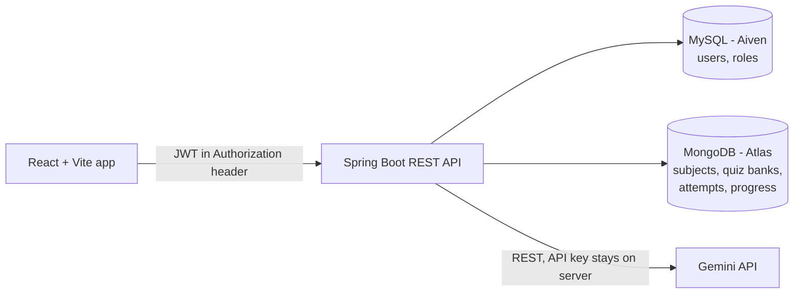

# Centralized E-Study Platform

A full-stack study platform for computer science students: structured subject notes, progress tracking, and **AI-generated quizzes built from the platform's own study material**.

**Live demo:** https://centralized-e-study.onrender.com
*(Hosted on Render's free tier. The first request after a period of inactivity can take about a minute while the service wakes up.)*

Registered with the Copyright Office, Government of India (Reg. No. L-155547/2024).

---

## Features

- **Accounts and roles:** register with full details (name, email, phone, branch, year), log in with username and password; students and admins get different permissions.
- **Study content:** subjects broken into topics, each with theory, examples, code and Q&A (served from MongoDB).
- **AI quiz per topic:** questions are generated from that topic's own content, not from generic knowledge.
- **Progress tracking:** mark topics as studied, see a progress bar per subject and overall.
- **My progress page:** study progress, quiz statistics (attempts, average, best score) and recent results.
- **Profile page:** user details opened from the avatar in the top bar, editable by the user.
- **Admin panel:** content management (subjects, topics, interview Q&A), user list with role management, and platform statistics.
- **Light and dark themes:** one-click toggle, remembered per browser.
- **One deployable unit:** a single Docker image serves the React app and the Spring Boot API.

## Architecture



**Why two databases?** MySQL holds structured, relational data (accounts and roles). MongoDB holds flexible documents (study material, generated questions, quiz attempts).

## Tech stack

| Layer | Technology |
|---|---|
| Backend | Java 21, Spring Boot 3.2, Spring Security, Spring Data JPA and MongoDB |
| Auth | JWT (jjwt), BCrypt password hashing, role-based access (STUDENT / ADMIN) |
| Frontend | React, JavaScript, Vite, CSS |
| Databases | MySQL (Aiven), MongoDB (Atlas) |
| AI | Gemini REST API called directly with Spring's `RestClient` (no SDK) |
| Deployment | Docker multi-stage build on Render |

## How the AI quiz works

1. A student opens a topic and clicks **Take AI quiz**.
2. The backend looks for a stored question pool for that topic. If none exists, it sends the topic's theory, example and code to the Gemini API and stores 10 validated questions.
3. Each attempt picks 5 random questions from the pool.
4. The browser receives questions **without** the correct answers. The server grades the submission, stores the attempt and returns a score with explanations.

Design decisions worth noting:
- **Questions are cached per topic**, so the AI is called once per topic instead of once per student. This keeps usage within free-tier limits.
- **Grading is server-side**, and a student can only submit their own attempt.
- **The AI response is validated** (exactly 4 options, valid answer index) before it is stored; malformed questions are dropped.
- **The API key is an environment variable** and is never sent to the browser or logged.

## Security

- Passwords are hashed with BCrypt. Accounts created before hashing was added are upgraded on their next successful login.
- Stateless JWT authentication; every `/api/**` route except login, register and reading subjects requires a valid token.
- Role checks on the server: everything under `/api/admin` requires `ADMIN`. Users cannot choose their own role at registration, and an admin cannot demote themselves or the last remaining admin.
- Profile data is validated on the server (names, email format, phone number, year of study) and a user can only read or edit their own profile.
- Error responses do not include stack traces.
- No credentials are stored in the repository; all secrets come from environment variables.

## API

| Method | Endpoint | Access | Purpose |
|---|---|---|---|
| POST | `/api/auth/register` | Public | Create a student account |
| POST | `/api/auth/login` | Public | Returns a JWT and the user's role |
| GET | `/api/subjects/all` | Public | List subjects |
| GET | `/api/subjects/{name}` | Public | Full content of one subject |
| POST | `/api/subjects/add` | ADMIN | Add a subject |
| POST | `/api/quiz/start` | Logged in | Start a quiz for a topic |
| POST | `/api/quiz/submit` | Logged in | Submit answers, get score and review |
| POST | `/api/progress/topic` | Logged in | Mark a topic as studied |
| GET / PUT | `/api/users/me` | Logged in | Read or update your own profile |
| GET | `/api/progress/summary` | Logged in | Progress, quiz stats and recent results |
| GET | `/api/admin/stats`, `/api/admin/users` | ADMIN | Platform statistics, user list |
| PUT | `/api/admin/users/{id}/role` | ADMIN | Promote or demote a user |
| POST / DELETE | `/api/admin/subjects[/{name}]` | ADMIN | Create or delete a subject |
| POST / PUT / DELETE | `/api/admin/subjects/{name}/topics[/{index}]` | ADMIN | Manage topics |
| POST / DELETE | `/api/admin/subjects/{name}/questions[/{index}]` | ADMIN | Manage interview Q&A |

A Postman collection is in [`postman/`](postman/).

## Project structure

```
src/main/java/com/pranav/estudy/
  config/ security/      Spring Security setup, JWT service and filter
  controller/ service/   REST endpoints and business logic (auth, subjects, quiz, progress)
  model/ repository/     MySQL entities and MongoDB documents
  dto/ exception/        Request/response objects and error handling
  seeder/                Starter subjects and first admin account
frontend/                React + Vite app (built into the Docker image): auth screens, dashboard, subject view, progress, profile, admin panel
database/migrations/     SQL migration notes
```

## Run locally

Requirements: JDK 21, Maven, Node.js 20+, MySQL and MongoDB (local or cloud test databases).

```bash
# 1. Set environment variables (see the table below), then start the API
mvn spring-boot:run

# 2. In a second terminal, start the React dev server
cd frontend
npm install
npm run dev
```

Open the address Vite prints (usually http://localhost:5173). It proxies `/api` calls to port 8080.

## Configuration

| Variable | Purpose |
|---|---|
| `SPRING_DATASOURCE_URL`, `SPRING_DATASOURCE_USERNAME`, `SPRING_DATASOURCE_PASSWORD` | MySQL connection |
| `SPRING_DATA_MONGODB_URI` | MongoDB connection |
| `JWT_SECRET` | Random secret, at least 32 characters (required in production) |
| `ADMIN_USERNAME`, `ADMIN_PASSWORD` | Creates the first admin at startup if it does not exist |
| `GEMINI_API_KEY` | Enables AI quizzes (free key from Google AI Studio) |
| `GEMINI_MODEL` | Optional; model name can be changed without a code change |
| `JWT_EXPIRATION_MS` | Optional; token lifetime, default 24 hours |

See `.env.example` for placeholders. Never commit real values.

## Deployment (Render)

The root `Dockerfile` builds the React app, packages it with the Spring Boot jar, and runs on `${PORT}`. Create a Render **Web Service** with the Docker runtime, add the variables above under *Environment*, and deploy.

## Roadmap

- Automated tests (JUnit, Mockito) and a GitHub Actions pipeline
- Rate limiting on login and AI endpoints
- Refresh tokens and token revocation
- Password reset by email

## Author

**Pranav Kharage** — Computer Engineering graduate (2026), Pune.
GitHub: [Pranavkharage](https://github.com/Pranavkharage)
